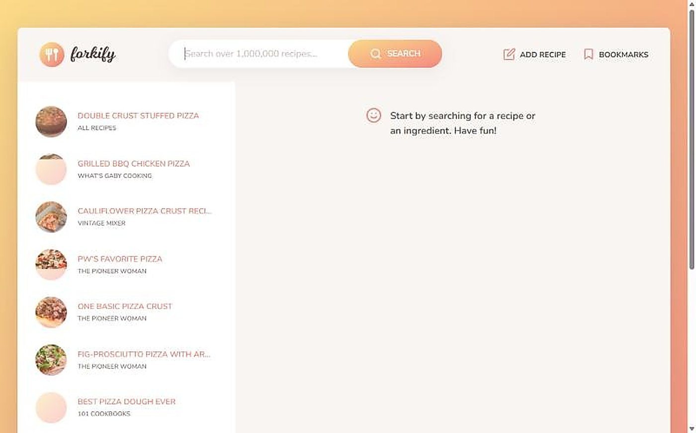
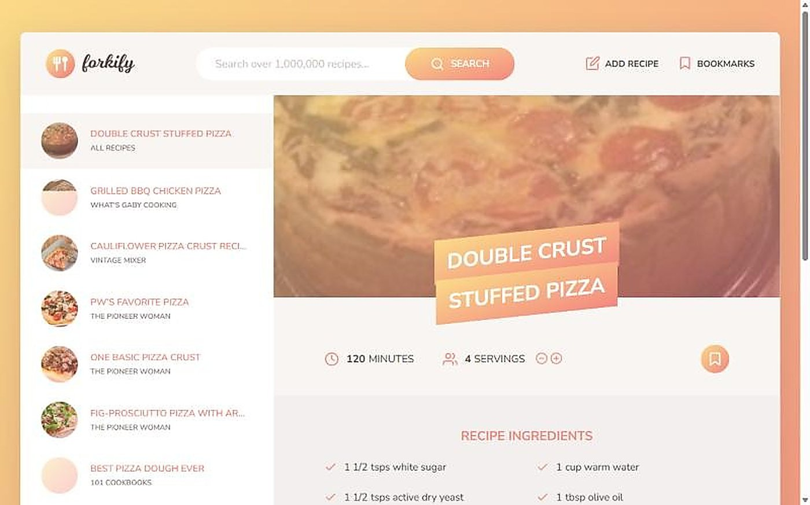
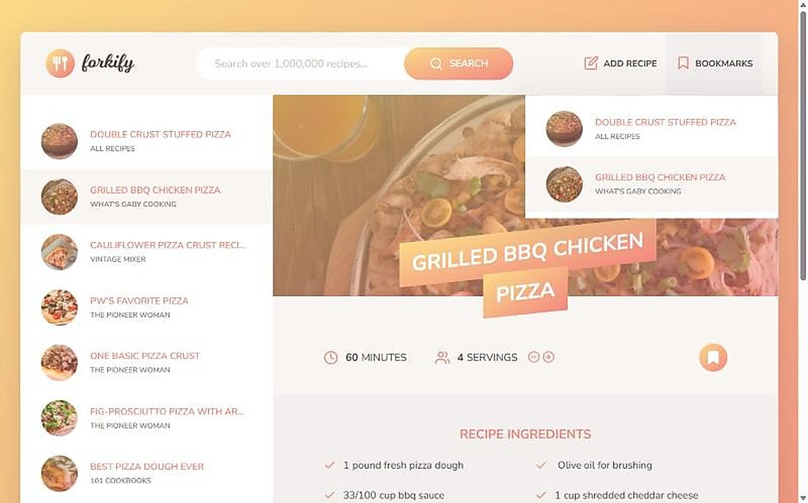

# Forkify

A recipe search app that talks to an online recipe API.

> Built while following a JavaScript course, so it shows what I learned rather than an original design.





## Features

- Model–view–controller structure: a model for data, separate views for search, results, recipe, pagination and bookmarks, and a controller that joins them
- Search results are shown ten per page with page buttons
- Servings can be adjusted and ingredient amounts update
- Recipes can be bookmarked; a form lets you add your own recipe
- Styled with Sass and bundled with Parcel

## Tech

JavaScript (ES modules), Sass, Parcel, [Forkify API](https://forkify-api.jonas.io/).

## Run

```bash
cd final
npm install
npm start
```

Then open the address Parcel prints (usually http://localhost:1234).

On Windows PowerShell, use `npm.cmd` if script execution is blocked.

### API key

Searching and viewing recipes needs no key. Adding your own recipe does: get a free key from the API site and put it in `final/src/js/config.js` (`KEY`). It is a placeholder in this repository.

## Author

Harun Kestendžić — [GitHub](https://github.com/harunkestendzic)
